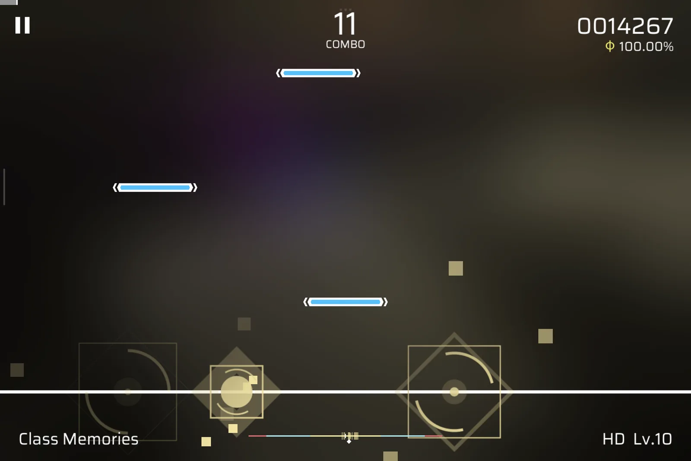
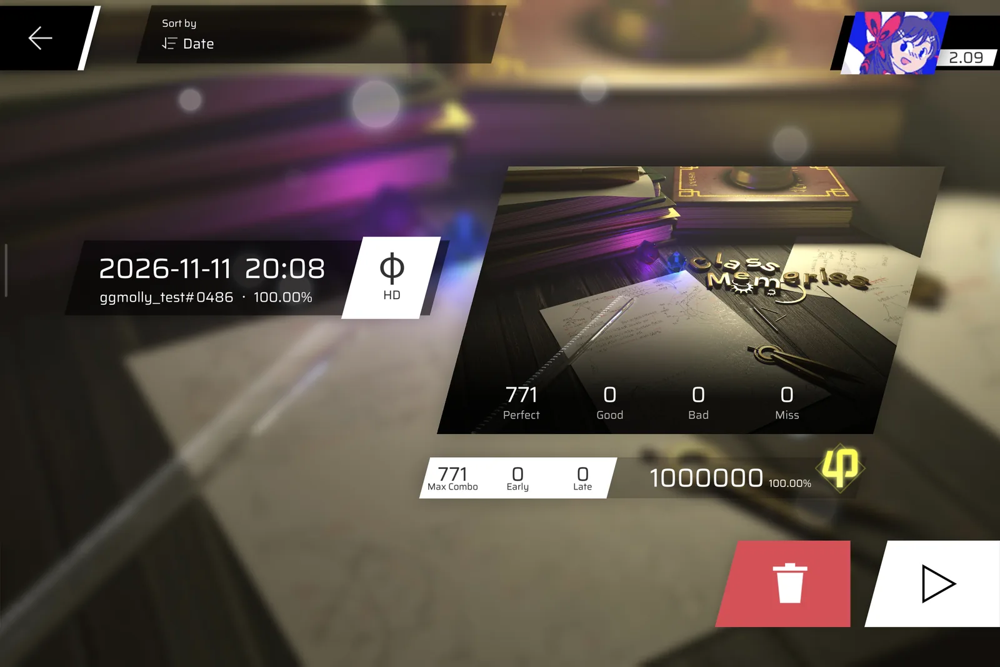
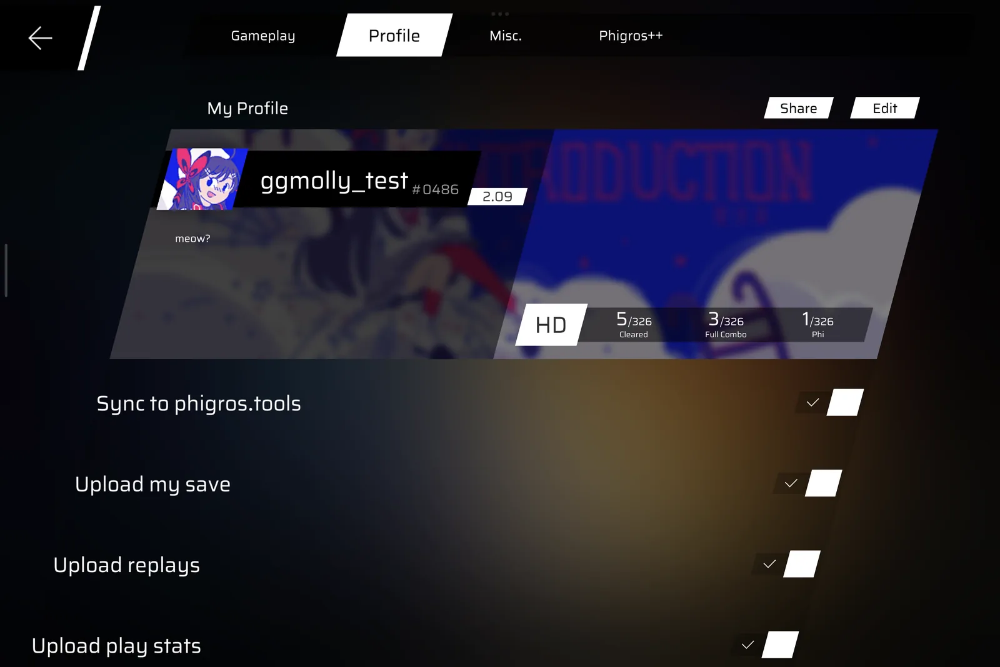
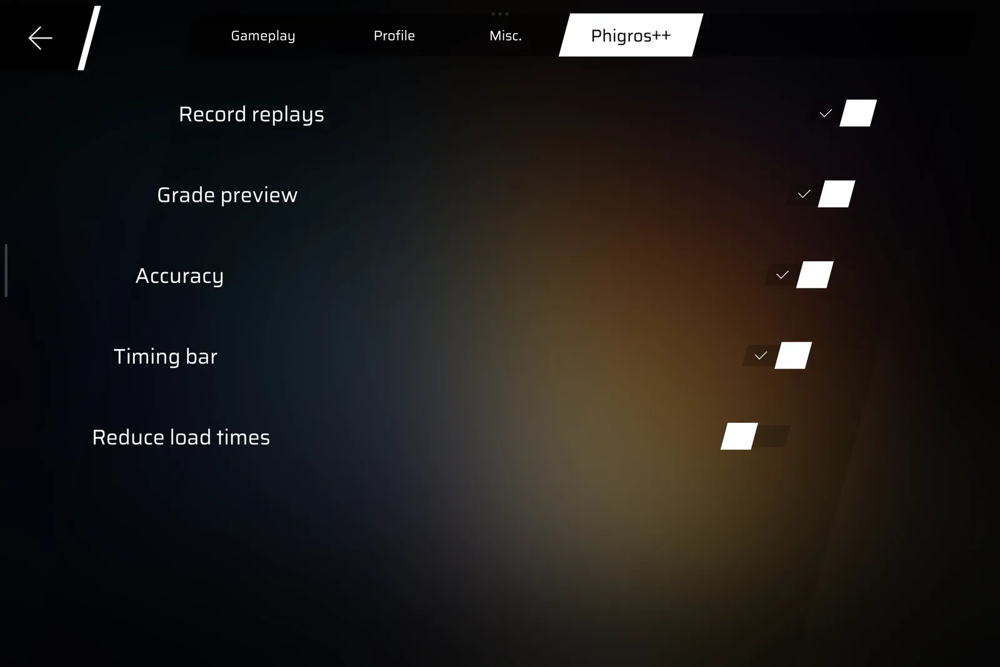

# Phigros++

Phigros++ brings mods to Phigros. It's a Lua mod loader built into the game's app: mods run inside the game, add their
own settings, pages and cosmetics next to the game's.

It comes with:

- **Replays**: every play is recorded and can be watched again from the song list, with a player to seek, pause and
  change the speed.
- **phigros.tools sync**: an opt-in profile on [phigros.tools](https://phigros.tools) with the player's records,
  replays and play stats.
- **A HUD** with the grade and accuracy the play is heading for and a hit error bar, and an option to skip the game's
  artificial loading delays.

| | |
|---|---|
|  |  |
|  |  |

The loader and these built-in mods update from inside the game. A new app is only needed when the game itself updates.

## Installing

Download the APKs of the [latest release](https://github.com/ggmolly/PhigrosPlusPlus/releases/latest) and install
them together, with `adb install-multiple -r *.apk` or an installer for split APKs like SAI. Phigros++ is an app of its
own, next to Phigros: log in with TapTap and download your cloud save to bring your progress over. Later releases
install over Phigros++ and keep everything. Each release's APKs can be rebuilt from this repository and checked
with `make verify`, see the wiki.

Your own mods go in `Android/data/sh.molly.phigrosplusplus/files/phigros++/mods/`. A mod runs with everything Phigros++
has, the key of your phigros.tools profile included, so only install mods you trust.

Writing mods and building Phigros++ are covered in the [wiki](https://github.com/ggmolly/PhigrosPlusPlus/wiki).
